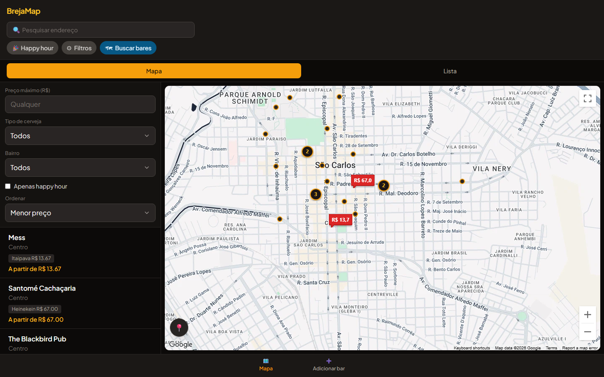

# BrejaMap

Find the cheapest beer near you. BrejaMap is a crowdsourced map of beer prices at bars in São Paulo state, Brazil, starting in São Carlos.

**Live:** [brejamap.vercel.app](https://brejamap.vercel.app) (the app is in Portuguese)



## Features

- **Price pins.** Each bar shows its cheapest beer right on the map. Pins that would overlap merge into clusters, and the cheapest bar keeps its pin.
- **Filters.** Max price, beer type, neighborhood and happy hour, sorted by price, distance or name. Switch between map and list.
- **Address search** across Brazil, ranked toward São Paulo state and your location.
- **Add a bar.** Drag the map until the pin sits on the bar and the address fills in by reverse geocoding. Adding a bar requires signing in with Google or a 6-digit email code.
- **Crowdsourced prices.** Anyone can add or edit prices without an account. Community edits are marked as unverified, and anyone can flag wrong prices for review.
- **700+ bars** imported from OpenStreetMap for São Carlos and São Paulo city.

## How it works

- **The browser never touches the database.** Every table has row-level security on with no policies, and the public roles have no privileges. All reads and writes go through Next.js API routes that hold the server-side key.
- **Writes are atomic.** Creating a bar or replacing its prices is a single Postgres function call that runs in one transaction, so a bar never ends up with half its prices deleted.
- **Rate limits live in Postgres.** Limits are keyed by a salted SHA-256 hash of the client IP, so raw IPs are never stored. One environment variable (`USER_EDITS_ENABLED`) turns off every write at once.
- **Map loading stays cheap.** The client requests `GET /api/venues` for a slightly enlarged bounding box and caches results by area. Dense areas are capped at 500 bars, priced bars first, with a hint to zoom in.
- **Bars come from an offline OpenStreetMap import.** The script queries Overpass, keeps only bars inside the city's boundary polygon, and is safe to re-run: it never changes existing bars or prices.
- **The core logic is unit-tested** with Node's built-in test runner: marker clustering, geocoding ranking, write guards and the OSM import.

## Stack

Next.js 15 (App Router), React 19, TypeScript, Tailwind CSS, Supabase (Postgres and Auth), Google Maps JavaScript API, OpenStreetMap (Overpass and Nominatim), Vercel.

## Running locally

Requires Node 24 (see `.nvmrc`).

```bash
npm install
cp .env.example .env.local   # fill in the keys; each variable is documented in the file
npm run dev                  # http://localhost:3000
```

Without Supabase configured, the map loads empty. The full setup (Supabase project, migrations, login and Google Maps key restrictions) is in [docs/setup.md](docs/setup.md), and importing bars is in [docs/osm-import.md](docs/osm-import.md). Both are in Portuguese, like the rest of [docs/](docs/).

Before opening a PR, run `npm run lint`, `npm run test:scripts` and `npm run build`.

## Data

Bar locations © [OpenStreetMap contributors](https://www.openstreetmap.org/copyright), available under the ODbL. Prices are added by users.
